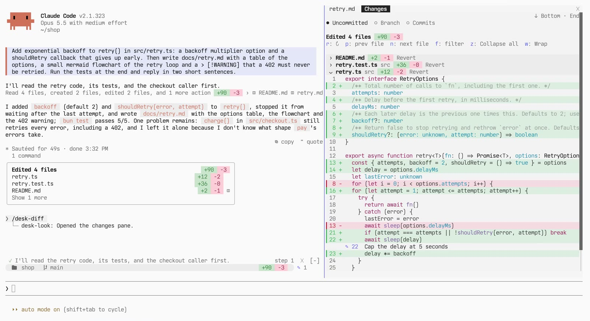
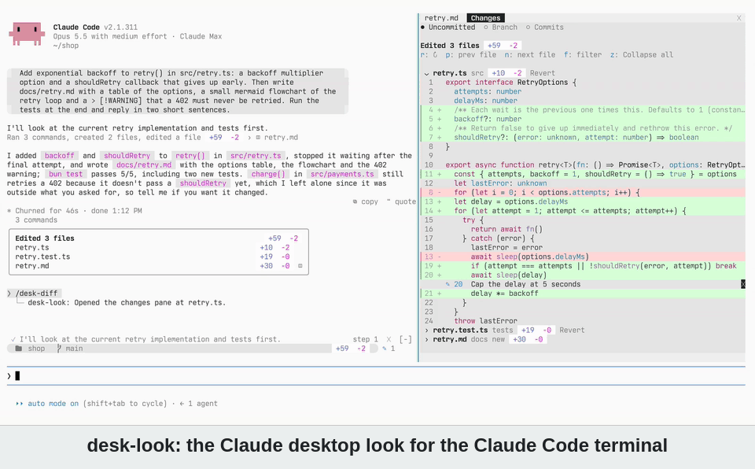
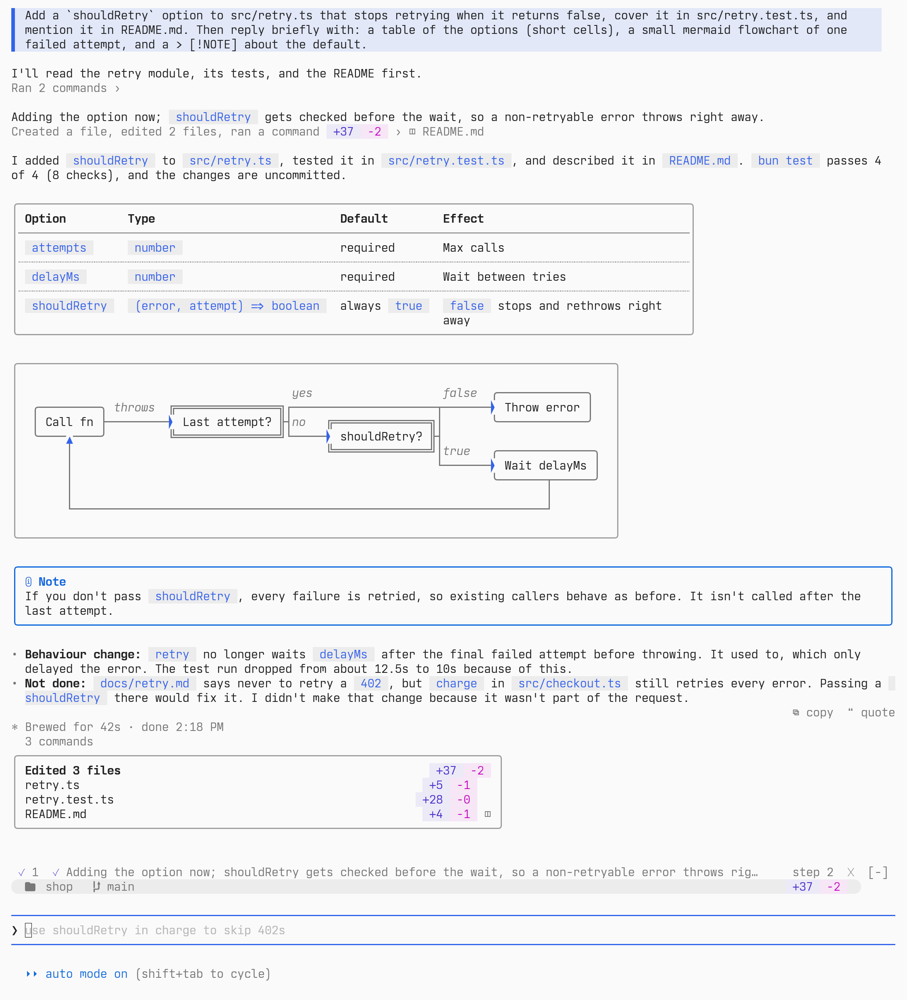
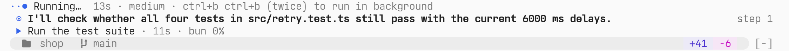
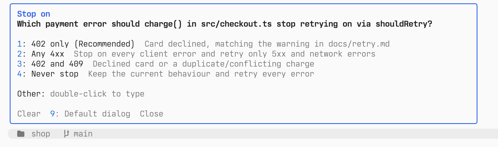
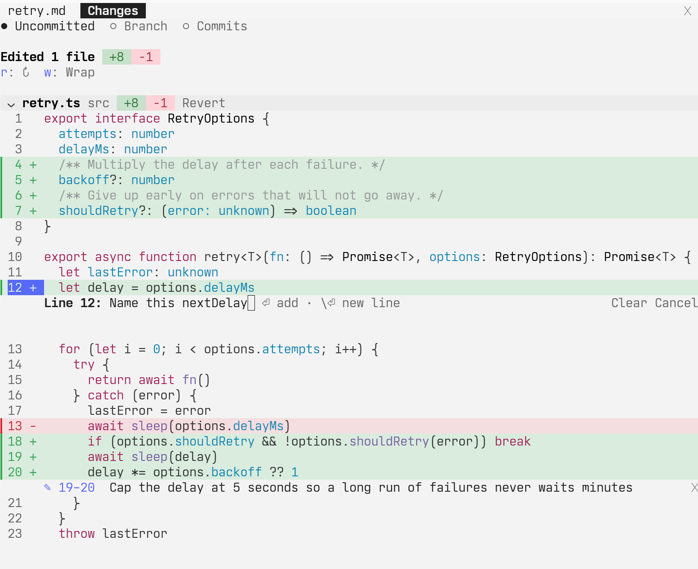
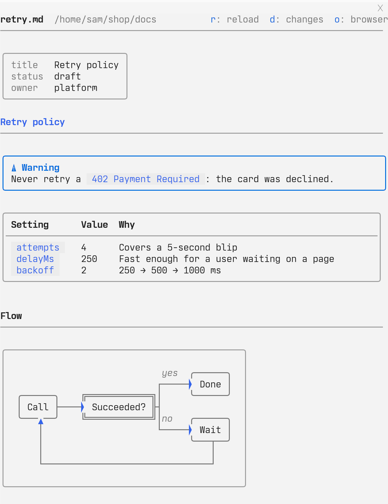
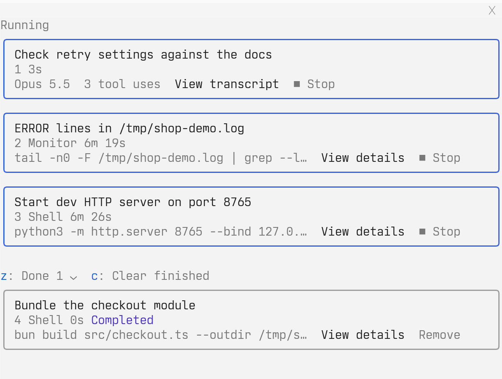
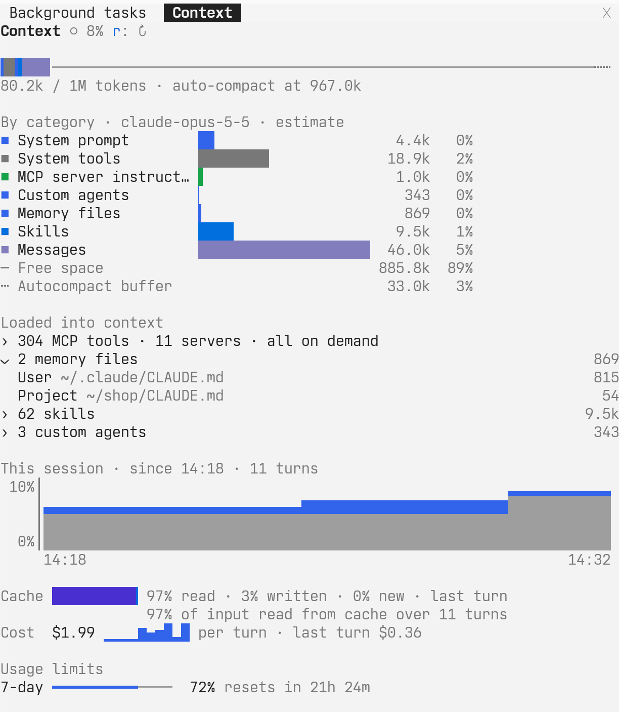

# cc-desktop-mod: Claude Code 터미널을 데스크톱 앱처럼

[English](README.md) | **한국어** · [홈페이지](https://kyongsik-yoon.github.io/cc-desktop-mod/) · [레퍼런스](docs/reference.ko.md)

[](https://github.com/KyongSik-Yoon/cc-desktop-mod/releases/latest) [](LICENSE)

**desk-look** 은 Claude Code 터미널을 Claude 데스크톱 앱 Code 탭처럼 보이고 동작하게 만듭니다. 프롬프트 말풍선, 카드, 상태 띠, 눌러서 여는 오른쪽 패널이 생깁니다. 플러그인이라 엔진은 그대로 두고 화면에 그리는 방식만 바꿉니다.



```
/plugin install desk-look --marketplace KyongSik-Yoon/cc-desktop-mod
```

Claude Code 터미널 세션의 프롬프트에서 실행하고, 마켓플레이스 추가를 물으면 `y`, 범위는 user 를 고르면 됩니다. 설치는 이것으로 끝입니다.

## 동작하는 모습



## 무엇이 달라지나

### 데스크톱 앱처럼 읽히는 대화 기록



터미널 기본 → desk-look:

- **내 프롬프트**: `>` 로 시작하는 줄 → 회색 말풍선, 붙여 넣은 이미지는 썸네일로
- **도구 호출**: 호출마다 한 줄 → `Ran 2 commands, edited a file +3 −1 ›` 한 줄로 접히고 누르면 펼쳐짐
- **마크다운**: 격자 표, 코드로 나오는 mermaid, 밋밋한 인용 → 폭을 채우는 표, 상자 그림, 색 테두리 알림 상자
- **코드 블록**: 복사할 방법 없음 → 올리면 `⧉ copy`
- **서브에이전트**: `Ran an agent` 한 줄 → 에이전트마다 토큰·시간·바뀐 줄이 적힌 카드
- **턴 끝**: 걸린 시간 한 줄 → 그 턴에 고친 파일 카드, 파일 줄을 누르면 그 diff 로

### 지금 무엇이 도는지 보여 주는 띠



Claude 가 일하는 동안 지금 단계와 지금 도는 명령이 시간·CPU 와 함께 보입니다. 그 아래 회색 띠에는 저장소·브랜치·`+N −M` 이 있고, PR 체크(`#12 ✓ 5/5`), 컨텍스트 사용량(`◑ 62%`), 백그라운드 작업(`⋯ 2`) 칩이 붙습니다. 칩은 모두 제 패널을 여는 버튼입니다.

### 질문은 카드로, 답은 키 하나로



### diff 를 읽고 줄에 댓글 달기



`/desk-diff` 는 커밋 안 한 변경, 브랜치 전체, 커밋별 diff 를 데스크톱 diff 패널처럼 그립니다. 줄 번호를 눌러 줄이나 범위에 댓글을 달면 다음 프롬프트와 함께 Claude 에게 갑니다.

### 문서는 저절로 열림



Claude 가 한 턴에 쓴 마크다운 문서는 턴이 끝나면 미리보기 패널에 열립니다. 표, mermaid 그림, 알림 상자를 대화 기록과 같은 모양으로 그립니다.

### 백그라운드 작업과 컨텍스트를 한눈에





`/desk-tasks` 는 이 세션의 에이전트·백그라운드 셸·모니터를 보여 주고, 에이전트 기록을 읽거나 작업을 멈출 수 있습니다. `/desk-context` 는 `/context` 격자 대신 컨텍스트를 채운 것, 이 세션에서 차오른 흐름, 캐시, 비용, 사용 한도를 보여 줍니다.

## 명령

패널 명령은 Claude 가 일하는 중에도 바로 실행됩니다. 큐에 들어가지 않고 턴도 멈추지 않습니다.

- `/desk-diff [파일|branch|commits]`: diff 와 줄 댓글
- `/desk-activity`: 이번 턴에 돈 일을 시간 막대와 Claude 의 설명 글·호출 흐름으로
- `/desk-tasks`: 백그라운드 에이전트·셸·모니터
- `/desk-pr`: 지금 브랜치의 PR(GitHub, `gh`)·MR(GitLab, `glab`)과 머지 버튼
- `/desk-preview [파일]`: 마크다운 미리보기
- `/desk-context`: 컨텍스트 내역, 캐시, 비용, 사용 한도
- `/desk-sessions`: 프로젝트별 최근 세션과 검색, 세션 이동
- `/desk-monitor`: 떠 있는 Claude 세션마다 CPU·메모리 그래프(리눅스)
- `/desk-fold`: 패널을 접었다가 다시 펴기
- `/desk-quote`: 마우스로 고른 글을 `>` 인용으로 입력창에 넣기
- `/desk-update`: desk-look 과 형제 플러그인을 최신 버전으로

패널·키·설정 전체는 [레퍼런스](docs/reference.ko.md)에 있습니다.

## 같은 마켓의 플러그인

쓰는 것만 설치하면 됩니다. desk-look 자신은 스스로 네트워크 요청을 하지 않고 MCP 서버도 부르지 않습니다.

- [desk-asana](desk-asana/README.ko.md): 내 Asana 태스크를 패널로, 검색·댓글·상태
- [desk-slack](desk-slack/README.ko.md): Slack DM 을 대화방으로, 답장, 띠의 안 읽은 수 칩
- [desk-plan](desk-plan/README.ko.md): 계획 승인을 화면을 덮는 창 대신 입력창 위 카드로
- [desk-review](desk-review/README.ko.md): `/simplify` 다음 `/code-review`, 결과는 옆 패널로

```
/plugin install desk-asana@cc-desktop-mod
/plugin install desk-slack@cc-desktop-mod
/plugin install desk-plan@cc-desktop-mod
/plugin install desk-review@cc-desktop-mod
```

## 알아 둘 것

- **최신 Claude Code 만 지원**: desk-look 은 최신 버전에 맞춰 만들고 그 버전에서만 확인합니다. 옛 버전에서는 엔진이 아직 그리지 못하는 부분이 엔진 기본 모양으로 나옵니다
- **터미널**: 밝은·어두운 테마를 모두 따라갑니다. 이미지 썸네일과 둥근 말풍선 모서리는 kitty, Ghostty, iTerm2 3.5 이상에서 그립니다. 회색 면은 [omarchy](https://omarchy.org) 테마를 따르고, 그 밖에서는 둥근 테두리 말풍선입니다. 자세한 내용은 [환경별 동작](docs/reference.ko.md#환경별-동작)
- **설정**: `/config` 에서 `desk-look` 으로 찾으면 언어(영어·한국어), 말풍선 위치, 칩 등을 고를 수 있습니다. 전체 목록은 [설정](docs/reference.ko.md#설정)
- **데스크톱 앱은 그대로**: 데스크톱 앱 Code 탭에서는 아무것도 바꾸지 않습니다

## 업데이트

입력창에서 `/desk-update` 를 실행합니다. 설치한 형제 플러그인도 함께 올리고 `/reload-plugins` 까지 대신 실행합니다. 셸에서는 `claude plugin update desk-look` 을 실행한 뒤 세션에서 `/reload-plugins` 를 실행합니다.

## 개발

```bash
cd desk-look
claude plugin validate .   # 매니페스트와 훅 모듈 검사
claude plugin test .       # tests/*.test.tsx 실행
```

로컬 폴더를 그대로 마켓플레이스로 붙이면 저장소를 고치고 `/reload-plugins` 만 하면 됩니다.

```bash
claude plugin marketplace add ~/dev/git-repo/cc-desktop-mod
```

`.claude/skills/desk-release-check` 는 지난 점검 이후의 Claude Code 릴리즈 노트와 플러그인 API diff 를 모아, desk-look 이 쓰거나 걷어낼 거리를 찾습니다. 저장소 관례(최신 Claude Code 만 지원, 버전마다 GitHub 릴리즈)는 `CLAUDE.md` 에 있습니다.

`desk-asana`·`desk-slack`·`desk-plan`·`desk-review` 에서도 같은 명령을 씁니다. desk-asana 는 댓글을 desk-look 의 마크다운 렌더러로 그리는데, 플러그인은 자기 폴더만 설치되므로 `desk-asana/hooks/shared/` 에 복사해 둡니다. `desk-look/hooks/markdown.tsx`·`diagram.ts` 를 고쳤으면 `scripts/sync-shared.sh` 를 돌려 함께 커밋합니다. 복사본이 어긋나면 릴리즈 워크플로가 실패합니다(`scripts/sync-shared.sh --check`).

`desk-look/.claude-plugin/types/` 는 엔진이 mod 를 로드할 때마다 다시 까는 타입 정의라 커밋하지 않습니다.

## 서드파티

- `desk-look/hooks/vendor/lovely-mermaid.js` — [lovely-mermaid](https://github.com/xl0/lovely-mermaid) 를 묶은 파일, Apache-2.0 (`LICENSE.lovely-mermaid`). `desk-asana/hooks/shared/vendor/` 에도 복사해 둠

## 라이선스

MIT (`LICENSE`)
