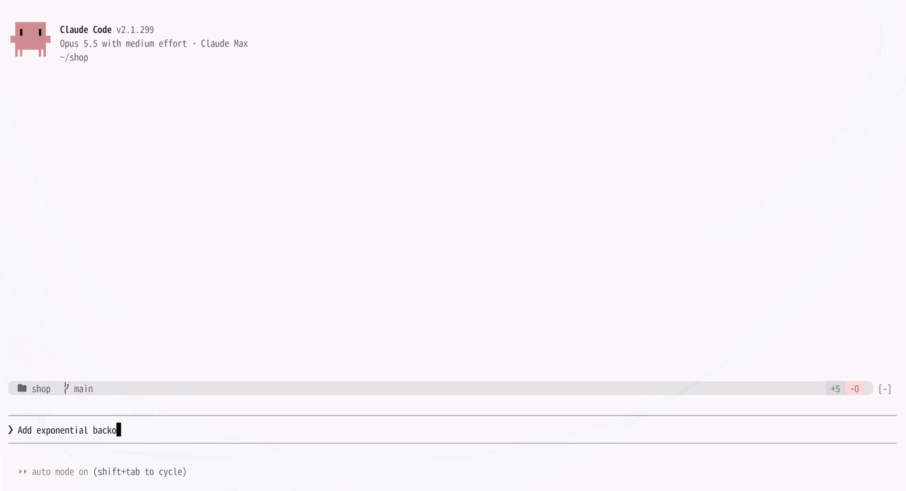
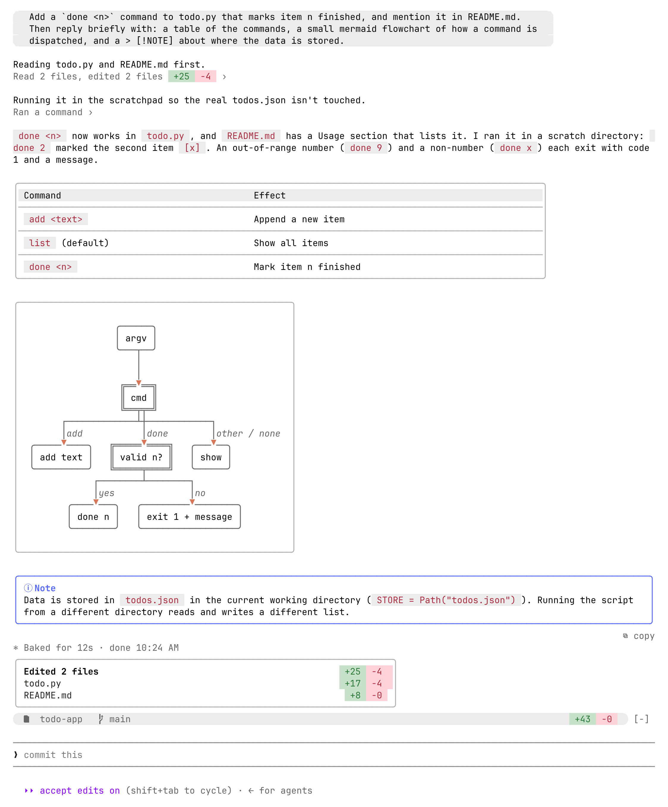
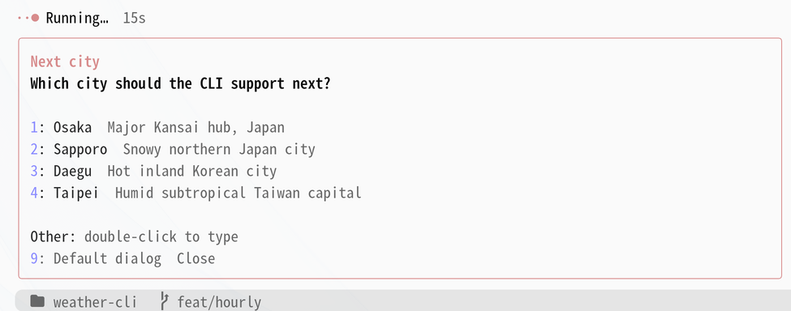
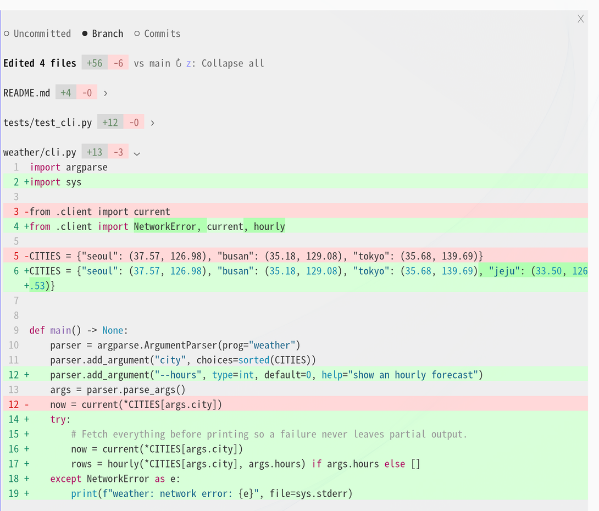
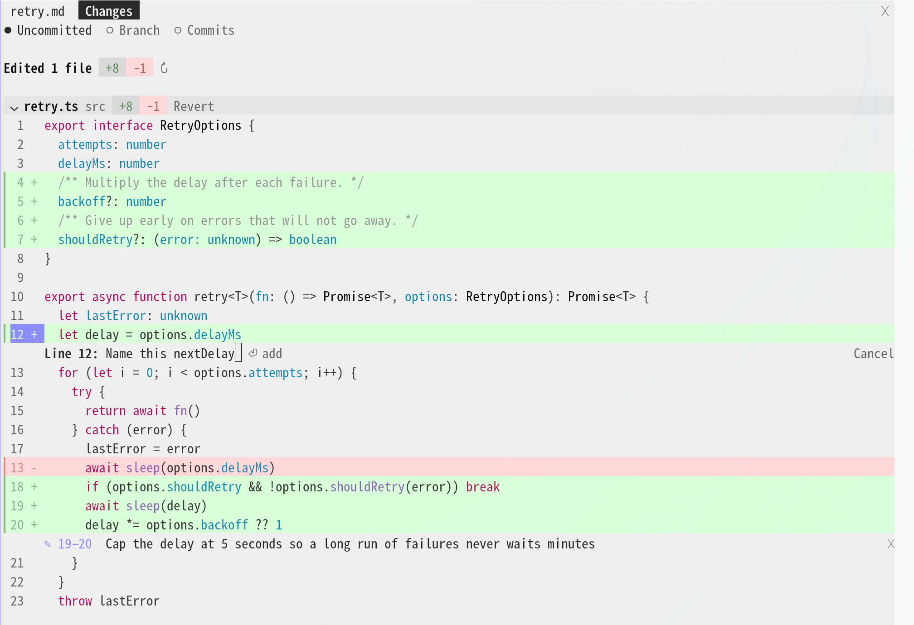
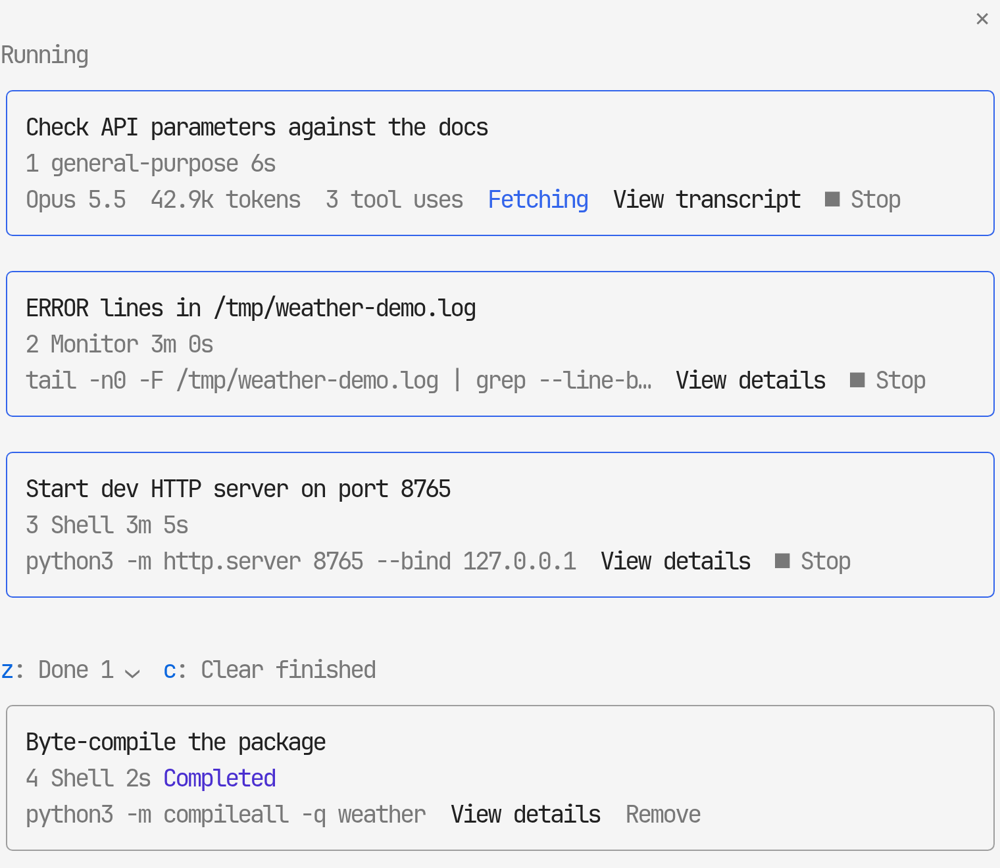
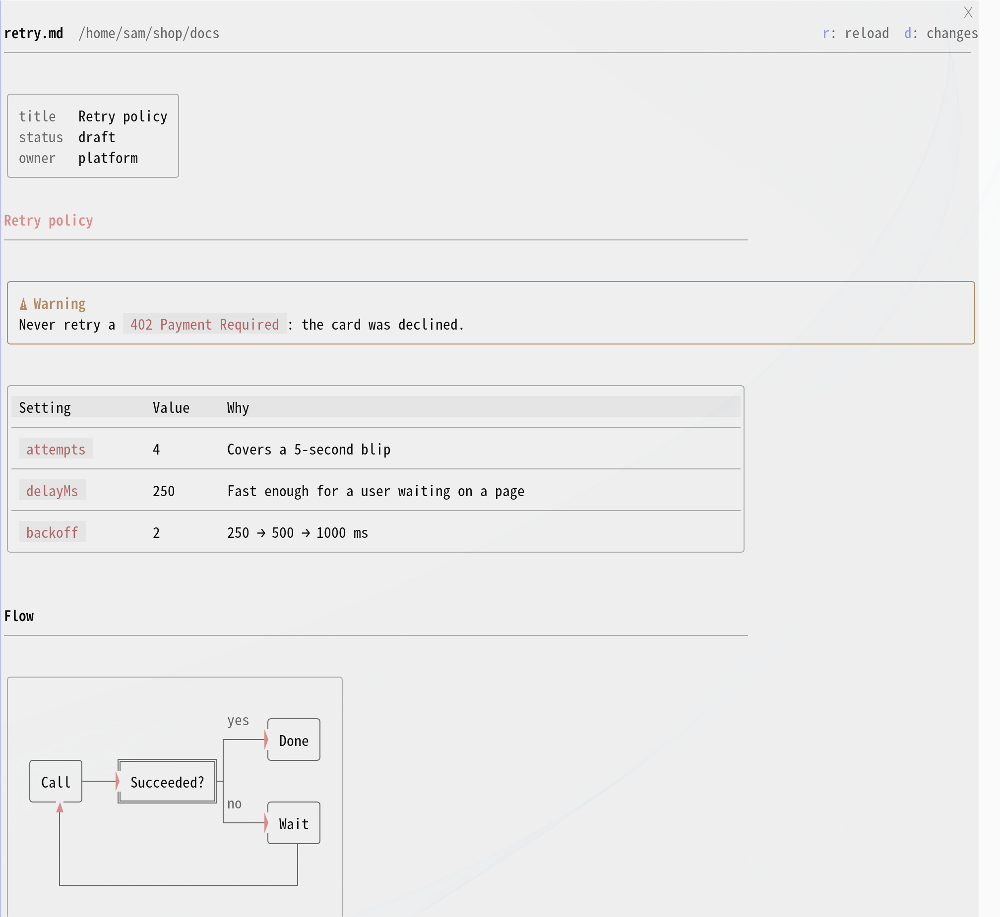
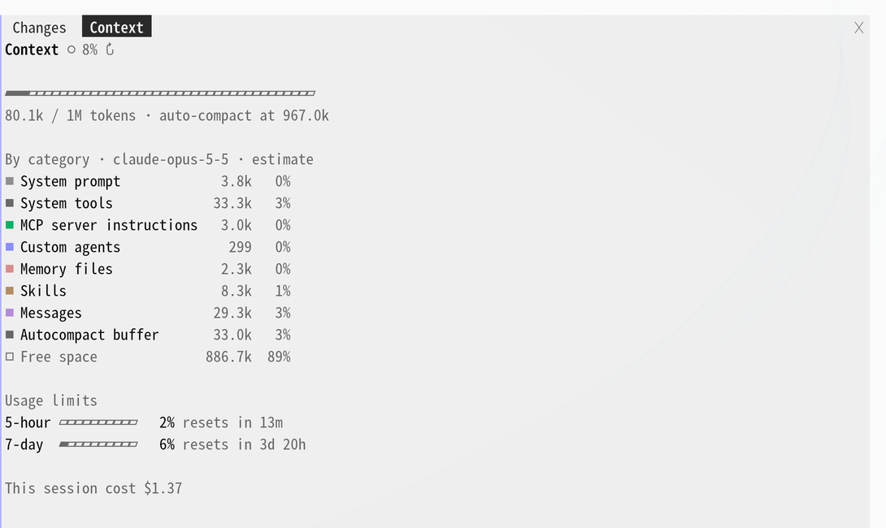

# cc-desktop-mod: Claude desktop look for the Claude Code terminal

**English** | [한국어](README.ko.md)

**desk-look** is a Claude Code plugin (mod) that makes the Claude Code CLI terminal UI look and work like the Code tab of the Claude desktop app.
It is a Claude Code function-hook plugin: the engine stays as it is, and only the way things are drawn on screen changes. Nothing changes in the Code tab of the desktop app (the `desktop` surface).



**At a glance**

- **A transcript that reads like the desktop app**: prompt bubbles, desktop-style markdown with full-width tables, mermaid diagrams and alert boxes, tool calls folded into one clickable line, a card per subagent, a plan card, a question card, and a card of the files each turn edited
- **A status band above the prompt**: repo, branch and `+N −M`, plus chips for the pull request's checks, context usage, running background tasks and unread Slack messages, and a task checklist
- **Eight side panes**, each opened by a command or by clicking a chip: diffs (`/desk-diff`), background tasks (`/desk-tasks`), the pull request (`/desk-pr`), your Asana tasks (`/desk-asana`), your Slack DMs (`/desk-slack`), Markdown preview (`/desk-preview`), context and usage limits (`/desk-context`) and recent sessions (`/desk-sessions`)
- **Diff line comments**: click a line number in `/desk-diff` to comment on a line or a range; the comments go to Claude with your next prompt
- **Markdown preview**: a document Claude writes in a turn opens in the preview pane when the turn ends
- **GitHub and GitLab**: PRs through `gh`, merge requests through `glab`
- **Asana**: the tasks assigned to you, a search across the workspace and your projects' tasks by section, their comments, and adding a comment, through the Asana MCP server Claude Code already has connected
- **Slack**: the DMs and group DMs sent to you as conversations, replying in them, and a notification when a new one arrives, through the Slack MCP server Claude Code already has connected
- **English or Korean** labels, following Claude Code's own language setting by default

## Commands

- `/desk-diff [file|branch|commits]`: Diff pane: uncommitted changes, the whole branch, or per commit
- `/desk-tasks [number]`: Background tasks pane: agents, background shells and monitors
- `/desk-pr`: The current branch's pull request or merge request, with a merge button
- `/desk-asana`: The Asana tasks assigned to you, a search across the workspace, or your projects' tasks by section: details, comments, adding a comment, assignee, dropdown fields and status
- `/desk-slack`: The Slack DMs and group DMs sent to you, as conversations: recent messages, replying, closing
- `/desk-preview [file]`: Markdown preview pane: a document drawn like the transcript
- `/desk-context`: Context breakdown, usage limits and session cost
- `/desk-sessions [number]`: Recent sessions by project, with search; switch to one
- `/desk-fold`: Fold the open panes away to give the conversation the width; run it again to unfold them at the same scroll position
- `/desk-quote`: Put the text you selected in the conversation into the prompt as a `>` quote, to ask about it
- `/desk-update`: Update desk-look to the latest version

The pane commands run at once even while Claude is working: they open the pane without queueing or stopping the turn.

## The transcript



Each item reads terminal default → desk-look.

- **Your prompt**: A line starting with `>` → A gray bubble (a pill for one line, a box with rounded corners for several), left (default) or right. Pasted images show as thumbnails above it, and long pasted text as a one-line `❐ Pasted text · N lines` chip that unfolds when clicked
- **Answers**: `●` bullet + engine markdown → A markdown renderer in the desktop prose style
- **Tables**: Grid tables → Full-width tables with a gray header and row separators
- **mermaid**: Code block → Box diagrams ([lovely-mermaid](https://github.com/xl0/lovely-mermaid)) with arrowheads that touch the boxes
- **`> [!NOTE]` alerts**: Blockquote → A box with a border colored by alert type
- **Code blocks**: No way to copy → Hover to see `⧉ copy` at the right of the top border; click to copy the same way `/copy` does
- **Tool calls**: One row per call + a result block → Consecutive calls fold into one line, `Ran 2 commands, edited a file +3 −1 ›`, that expands on click. Expanded, edit diffs show right away (file line numbers, three lines of context), in the desktop diff style when the terminal theme is known. The ctrl+o transcript keeps the engine's full rows
- **Subagents**: One `Ran an agent` line; notifications and messages only expand with ctrl+o → A card per agent (type and description; tool count, tokens, time and changed lines; click for the result). Background notifications read `✓ description completed · 5s`; click an agent message `◆ name first line ›` to expand it in place. When a turn ends waiting on background agents, a row per agent under `Waiting for N background agents to finish`, `··· type description ›` (its status once it ends); click it for that agent in `/desk-tasks`
- **Plan (ExitPlanMode)**: Folded into one line with other tools → A card of its own, `◇ Plan Approved` (it also shows waiting, rejected and interrupted), with the plan as markdown. A long plan shows its start and expands with `Show all`. The approval dialog is the engine's own
- **Questions (AskUserQuestion)**: A list under the prompt → A question card right above the prompt. With an empty prompt, pick by number alone (`1`-`8` options, `0` submit, `9` the default dialog); multi-select with ☐/☑; `Other` takes two clicks to type (the first selects the row), in a field that grows to four lines; hover an option for its preview. A notification goes out when the card opens, as the engine dialog does (`preferredNotifChannel`). The transcript records `Asked question → answer`
- **End of turn**: A duration line → A card of the files edited that turn, `Edited N files +N −M` (click a file row to open the `/desk-diff` pane at that file), and `⧉ copy` at the right edge to copy the answer, with `❝ quote` beside it to put the text you selected in the conversation into the prompt as a quote
- **Command output**: Plain text → Output with tables, headings, code or quotes renders as markdown, like an answer



## Around the prompt

Each item reads terminal default → desk-look.

- **Chin band**: A rounded gray band like the chin under the desktop prompt: `repo  branch` on the left, `+N −M` on the right (click it for the `/desk-diff` pane), and `✎ N` while diff line comments wait for your next prompt
- **PR chip**: The current branch's pull request: `#12 ✓ 5/5`, `✗ 1` failing, `● 3/5` running, `◆ 2` unresolved review threads. GitLab merge requests show as `!7` with pipeline jobs and unresolved discussions. Click it for the `/desk-pr` pane
- **Context chip**: Once context passes half, `◑ 62%` (caution color from 75%, warning color from 90%). Click it for the `/desk-context` pane
- **Tasks chip**: `1 shell still running` → While background tasks run, `⋯ 2`. Click it for the `/desk-tasks` pane
- **Checklist**: Tool lines → A card above the prompt, `Tasks 2/5` (✓ done, ◉ in progress, ○ to do). Only in sessions that have `TodoWrite` or `TaskCreate`
- **Progress**: `✻ Simmering… (12s · ↓ 300 tokens)` → `●·· Running…  2m 29s` (a word that matches the work, clay-colored dots)
- **Mode indicator**: Dim text at the bottom right of the prompt → A pill chip (with the omarchy theme)
- **Hint line**: `? for shortcuts` → While a question card is open, ends with the keys that answer it (`pick by number · 9 default dialog · Esc cancel`)

## Side panes

Each pane opens on the right of the terminal, next to the transcript.

### `/desk-diff [file]`: diffs



Per-file diffs in three scopes, like the desktop diff panel:

- `Uncommitted`, `Branch` (the whole branch since it left the base branch, via `merge-base`) and `Commits` (click a commit to expand its diff)
- Give a file name (the end of the path is enough) to scroll to it, or `branch` / `commits` to open in that scope
- The pane opens as a folded list of files. Click a file's header row to unfold its diff and scroll to it; the file that was open folds, so one file is open at a time. Click it again to fold it. `z` unfolds or folds them all for reading every change in one scroll (in `Commits`, every commit and its files at once; several commits can stay open)
- `n` / `p` go to the next or previous file: with one file open, they open that file (folding the current one); with several open (after `z`), they scroll to its header
- `f` opens a file filter above the list: type parts of a path (separated by spaces, all must match) to keep only matching files, and Enter opens the first. `✕` clears and closes it
- In `Branch` and `Commits`, click `vs <base> ⌄` to pick the base from the most recently committed local and remote branches, or `auto` to go back to the detected one (the PR's base, origin's default branch, then main, master or develop)
- Click `N unmodified lines` to show those lines in place, read from the file as it is now (in `Commits`, from that commit)
- Uncommitted files have `Revert`: press it twice within 5 seconds to `git restore` (not offered for new files)
- Drawn like the desktop diff panel when the terminal theme is known (Omarchy): a header band per file, full-width green and red rows with a colored edge, one line-number column, syntax colors on removed lines too, changed words in a darker tint, and unchanged stretches as `N unmodified lines`. Only the rows near the visible part are drawn, so a diff of thousands of lines scrolls as fast as a short one. Edits made this session outside git are grouped under `Edited this session, outside git` (click it to fold the group), each edit on its own, split by `· next edit`. Without a known theme, the engine's diff is used as before
- Line comments, like the desktop diff panel's: click a line number to open a comment field under it, click another line number in the same file to make it a range, and press Enter to keep the comment (it can run over several lines: type a new line as in the prompt). Kept comments stay under their lines (`✕` removes one) and as a `✎ N` chip in the chin band, and go with your next prompt as context Claude reads (the file and lines, the lines themselves, and your comment), then clear. Slash commands don't take them. Needs a known theme, like the drawing above



### `/desk-tasks [number]`: background tasks



Like the desktop's Background tasks: this session's agents, background shells (`run_in_background`, Ctrl+B or a timed-out command) and monitors, under `Running` and `Done`.

- **Agents** show their model, tokens, tool uses and what they are doing now (`Fetching`). `View transcript` shows the prompt, their messages, their tool calls folded as in the transcript, and their report. `Open in main view` puts the agent's full transcript in the main view, where your next prompt goes to that agent; the card of the agent in view reads `◉ In view`, and `‹ Main conversation` goes back
- **Shells and monitors** show their command. `View details` shows status, runtime, the result line and the end of the output (once it finishes)
- `■ Stop` stops a running task after a second press within 5 seconds
- `z` folds `Done`, `c` clears finished tasks from the list, `Remove` clears one
- Click a card or give its number to open it; `‹ Back`, at the top and again at the bottom of the details, goes back to the list

### `/desk-pr`: pull request

The current branch's PR (GitHub, through `gh`) or MR (GitLab, through `glab`):

- State, `base ← head`, `+N −M`, review decision and merge state
- Failing and running checks (passing ones folded) and unresolved review threads
- `Hand to Claude` next to a failing check or a review thread fills the prompt with it
- `Merge` merges it after a second press within 5 seconds, only at the head commit the pane showed (a newer push makes the merge fail). While checks are still running it reads `Merge when pipeline succeeds` (GitLab) or `Merge when checks pass` (GitHub) and sets auto-merge instead. It shows only on an open, non-draft PR with no failing checks that the host reports as mergeable. The merge method is the repository's: GitLab follows the MR's squash setting; GitHub uses merge, else squash, else rebase, whichever the repository allows. The remote source branch is deleted (on GitHub, after an auto-merge only if the repository deletes head branches); the local branch is left alone
- Nothing else is changed: no approvals, comments or `Ready for review`

### `/desk-asana`: Asana tasks

Your open Asana tasks, read through the Asana MCP server Claude Code already has connected (no token or setting of its own). It uses Asana's official V2 server (`https://mcp.asana.com/v2/mcp`, the one with `get_my_tasks`) when one is connected, otherwise the claude.ai Asana connector; on the connector, listing your tasks needs a Premium workspace (Asana's task search). With neither, the pane says to connect Asana in `/mcp`.

- The list groups your incomplete tasks by project, with the due date at the end of the row (red when overdue). Below them, `Done in the last 14 days` shows the tasks completed in the last 14 days, dimmed, with their status (`● On hold`). Depending on the task type, statuses such as on hold or waiting for release count as complete in Asana, so a task moved to one of them can still be opened from the pane
- The `● My tasks ○ Projects` tabs at the top switch views. `Projects` lists the projects you are a member of, most recently changed first (member count, and open task count on the V2 server). Click one for its open tasks, whoever they are assigned to, grouped by section with the assignee and due date (sections with no open task are left out), and tasks completed in the last 14 days in a `Done in the last 14 days` group at the end; click a section row to fold it, or `Collapse all` (`z`) to fold or unfold every section. Up to 300 open tasks are read per project. `← Projects`, at the top and again at the bottom, goes back to the list
- The `Search` box above it finds open tasks anywhere in the workspace you can see, by name, description or comment (the 50 most recently changed), shown the same way with each task's assignee; `✕ My tasks` or an empty search goes back to your tasks. Search needs a Premium workspace (Asana's task search)
- Click a task for its details: the task type's status (`● Open`), projects and sections, assignee, due date, custom fields, the description and the latest 30 comments (on the claude.ai connector, the comments among the task's first 100 activity entries). `↻` (`r` in every view) reloads, `← Tasks` (also at the bottom) goes back to the list, the search or the project
- Write a comment in the box at the bottom and press Enter to add it on Asana. `@ Mention` below it finds people by name or email; pressing one puts `@Name` in the comment, and it is sent as an Asana @-mention (which notifies them) as long as the `@Name` is still in the text when you send
- `✎ Edit` next to one of your own comments edits it in place (Enter saves). The Asana MCP servers have no tool for editing a comment, so this one call goes to Asana's REST API with a personal access token you put in yourself: create one at https://app.asana.com/0/my-apps, put it in `Asana personal access token` under `/plugin configure desk-look@cc-desktop-mod` (kept in secure storage) and choose `Save configuration`, which reloads the plugin. Without a token, `✎ Edit` explains this and calls nothing. Only the characters you change are written back into the comment's original rich text, so mentions, links, bold, lists, code blocks and images you did not touch stay exactly as they were. List marks (`• `, `1. `), images (`[image]`) and the letters of a mention or link are shown but cannot be changed here (a whole mention can be deleted); an edit that touches them is refused and kept in the box. Only comments the token's owner wrote can be edited
- `Change` next to the assignee finds people by name or email (or `Me`); handing the task to someone takes a second press within 5 seconds
- `›` next to a dropdown custom field lists its options; press one to set it
- `Hand to Claude` fills the prompt with the task's title, link, status, description and recent comments
- `Change` next to the task type's status (Open, In Progress…) lists the type's statuses; picking one changes it. The Asana MCP servers drop this key, so like `✎ Edit` it goes to Asana's REST API only when you have put in a personal access token; without one, `Change` explains how and calls nothing
- These Asana calls are made only when you open the pane or press something in it, and they go through Claude Code's permission check like Claude's own calls: auto mode refuses them and the default mode asks each time, unless an allow rule covers them. Add the pane's tools to `permissions.allow` in `~/.claude/settings.json`; while some are missing, the pane lists them. For the V2 server:

  ```json
  "mcp__asana-v2__get_my_tasks", "mcp__asana-v2__search_tasks", "mcp__asana-v2__get_task",
  "mcp__asana-v2__add_comment", "mcp__asana-v2__update_tasks", "mcp__asana-v2__search_objects",
  "mcp__asana-v2__get_me", "mcp__asana-v2__get_projects", "mcp__asana-v2__get_tasks"
  ```

  The rule allows the same tools for Claude too, including adding comments and changing tasks

### `/desk-slack`: Slack DMs

The DMs and group DMs other people sent you, kept as conversations like the Slack client, read through the Slack MCP server Claude Code already has connected (the claude.ai Slack connector; no token or setting of its own). Messages, @mentions and thread replies in channels are not included (thread replies in a DM are). With no Slack server, the pane says to connect Slack in `/mcp`.

- The list shows one row per conversation, most recent first: `●` when it has messages you have not opened in desk-look, the people in it, the last message and how long ago. The first time, it fills in the last 3 days as already read
- Click a conversation for its latest 30 messages, both sides. Write in the box at the bottom and press Enter to reply there. `↻` reloads, `← Conversations` (also under the reply box) goes back
- Under a message with replies, `N replies` opens that thread (the message and its latest 30 replies), and a reply written there goes to the thread. `← name` goes back to the conversation. When a conversation's last message is a thread reply, clicking it in the list opens that thread directly
- `✕` closes a conversation, and `Close all` at the top closes every conversation in the list (both need a second press within 5 seconds). A closed conversation comes back when a new message arrives in it
- `Hand to Claude` fills the prompt with the conversation's recent messages; `Open in Slack` opens it in Slack
- While any Claude Code session is running, desk-look checks for new messages once a minute and sends a notification per conversation through your notification channel (`slackNotify` turns that off). The `✉ N` chip in the band shows the unread count and opens the pane. With several sessions open, one of them checks and the others share what it finds
- "Unread" is desk-look's own: opening a conversation here does not mark it read in Slack, and reading it in Slack does not clear it here
- The Slack connector adds a "Sent using Claude" line to messages sent through it
- desk-look calls Slack only while all four of its Slack tools have an allow rule in `permissions.allow` in `~/.claude/settings.json`; until then it calls nothing (no checking, no notifications) and the pane lists the missing rules. The check runs in the background, where nobody could answer a permission prompt:

  ```json
  "mcp__claude_ai_Slack__slack_search_public_and_private", "mcp__claude_ai_Slack__slack_read_channel",
  "mcp__claude_ai_Slack__slack_send_message", "mcp__claude_ai_Slack__slack_read_user_profile"
  ```

  To open threads, add `"mcp__claude_ai_Slack__slack_read_thread"` too. Without just that rule, checking, notifications and conversations keep working; threads do not open, and the conversation shows the rule to add

  The rule allows the same tools for Claude too: Claude can then send Slack messages without asking

### `/desk-preview [file]`: Markdown preview



- Draws a Markdown document with the transcript's own renderer: bordered tables, mermaid diagrams, alert boxes, code blocks with `⧉ copy`. Headings are set apart (`#` in the accent color, `#` and `##` underlined), and YAML front matter becomes a small key/value box at the top
- Opens three ways: the `◫ preview` chip at the end of a tool line that wrote or edited a `.md` file (a folded group line names the file, `◫ NOTES.md`), the `◫` next to a `.md` row in the end-of-turn card, and `/desk-preview <file>` (no file reopens the last one)
- A document Claude writes in a turn opens by itself when the turn ends, not while it is still being written. Files under a `.claude/` folder (memory, plans, skills) never open by themselves; `previewAutoOpen` turns this off
- Follows the document: later writes and edits reload it. `r` reloads by hand, `d` opens the document in the diff pane, `o` opens it full-window in your default browser (the dock can't grow past 45% of the terminal). The page is written to a temporary folder (`/tmp/claude-<uid>/desk-look/`), relative images and links resolve against the document's folder, and mermaid diagrams render when online
- Claude can open it too (the `preview` tool), for example when asked to show a README
- Documents over 90,000 characters are drawn up to that point, with a note. The desktop app keeps its own Markdown

### `/desk-context`: context and usage



Replaces the `/context` grid:

- A context bar (tokens / window, the auto-compact point)
- A per-category breakdown, the same categories as `/context` (a local estimate, so no API requests)
- 5-hour and 7-day usage limits with time until reset, and the session cost
- `↻` recalculates

### `/desk-sessions [number]`: recent sessions

Recent sessions grouped by project, with a search box at the top (title and folder; Enter opens the first result). Only the current folder's group starts expanded: click a group's header to expand or collapse it, or press `z` to collapse or expand them all; a search expands everything. `f` moves to the search box and `r` refreshes. Sessions that are open right now carry a chip at the end of the row, read from `claude agents --json`: `background` (idle), `working`, `needs input` for background sessions, and `open elsewhere` for a session open in another terminal.

Click a row or give its number:

- **A session in the same folder**: the current window switches to that session right away (runs `/resume <id>`). If running it is blocked, the command is placed in the prompt; press Enter.
- **A session in another folder**: the current window moves to that folder (`/cd`) and switches to it. If running the commands is blocked, `cd <folder> && claude --resume <id>` is copied to the clipboard (`wl-copy`).
- **A running background session**: stops it with `claude stop <id>` (its conversation is kept), then switches to it as above. If it is working, the first press asks you to press again, because stopping cuts its turn short.
- **A session open in another terminal**: inside [herdr](https://herdr.dev), switches herdr to the tab where it is open; elsewhere only a notice, continue it in that window.

---

Tool lines, agent cards, agent messages, background task cards, session rows, question options, the context, PR and tasks chips, commit rows, and file rows in the end-of-turn card and the diff pane are buttons across the whole row, so clicking the description or the `›` works too.

## Install

desk-look follows the latest Claude Code release and is tested only there; keep Claude Code up to date. On an older version, parts the engine can't draw yet fall back to its default look.

At the prompt of a Claude Code terminal session:

```
/plugin install desk-look --marketplace KyongSik-Yoon/cc-desktop-mod
```

Answer `y` when asked to add the marketplace, and pick the user scope.

## Settings

Search for `desk-look` in `/config` to find these options.

- `language`: `auto` (default), `en`, `ko`. Language of the mod's own labels, panes, toasts and the text it puts in the prompt. `auto` follows Claude Code's `language` in `/config` when the session starts: Korean when it names Korean, English otherwise
- `bubbleSide`: `left` (default), `right`. Where your prompt bubble sits. The attachment lines the engine draws under the bubble (`└ 1 skill available` and so on) can't be moved by a plugin and always sit on the left, so `left` keeps them aligned. `right` is like the desktop app
- `askNotify`: `on` (default), `off`. Notify when a question card opens. The engine dialog notifies when it opens, but the engine sends nothing while the card is showing, so the card sends it itself
- `prBar`: `on` (default), `off`. The PR chip next to the band. It reads the current branch's PR with `gh` (GitHub) or `glab` (GitLab) at session start and after each turn, at most once every 30 seconds, and, while a check (GitLab: a pipeline job) of an open PR is still running, between turns too: every 15 seconds, doubling up to every 2 minutes while nothing changes (a check that never reports, such as one waiting for a runner, would otherwise keep asking); without either tool, or in a repository on neither host, it stays hidden and is not asked again for that branch; network errors are retried after the next turn. `/desk-pr` opens regardless of this setting
- `previewAutoOpen`: `on` (default), `off`. Open a Markdown document Claude writes in the preview pane when the turn ends. `off` leaves it to the `◫` chips and `/desk-preview`
- `slackNotify`: `on` (default), `off`. Notify when a new Slack DM arrives (see `/desk-slack`). `off` keeps checking for the pane and the `✉` chip, without notifications
- `asanaToken`: empty (default). An Asana personal access token, optional. Only `✎ Edit` on your Asana comments and changing a task type's status use it (see `/desk-asana`); set it with `/plugin configure desk-look@cc-desktop-mod`
- `contextChip`: `auto` (default), `always`, `off`. The context chip next to the band above the prompt. `auto` shows it only from 50% (a status line or another plugin often shows context all the time already), `always` always shows it, `off` hides it. The `/desk-context` pane opens regardless of this setting

## Update

Run `/desk-update` at the prompt, or from a shell:

```bash
claude plugin update desk-look
```

Then run `/reload-plugins` in your session.

## Behavior by environment

- **Colors**: uses engine theme keys (`text`, `inactive`, `claude` …), so both light and dark themes are followed.
- **Gray bubble fill**: drawn only when the [omarchy](https://omarchy.org) theme (`~/.local/state/omarchy/current/theme/colors.toml`) can be read; a theme change is picked up within 3 seconds. Elsewhere the bubble is a rounded border. The rounded ends use Nerd Font half-circle glyphs and Symbols for Legacy Computing blocks; where the terminal draws images (see below), the corners of a multi-line bubble are small images instead, so they come out properly round. The chin band above the prompt works the same way: without the theme it draws only the chips, with no gray band.
- **Image thumbnails and round bubble corners**: drawn in kitty and Ghostty, and in iTerm2 3.5 or later under fullscreen rendering (a pasted image over 2 MiB stays as `[Image #N]` there); not inside tmux or zellij. Inside herdr they need both `kitty_graphics = true` under `[experimental]` in herdr's `config.toml` and `CLAUDE_CODE_FORCE_TERMINAL_IMAGES=1` for Claude Code, which otherwise asks the terminal's name and gets herdr's.
- **Question card**: used only in sessions with a single terminal attached. With Remote Control on, the card opens only when your last message came from the terminal, and if nobody touches it for a minute it hands over to the engine's default question dialog so the mobile or web app can answer; a last message from the app opens the default dialog right away. Esc stops the turn, so it also cancels the question.
- **Diff colors in 256-color terminals**: the blended row and word tints are used only when `COLORTERM` is `truecolor` or `24bit` outside tmux. Elsewhere (tmux turns the engine's colors down to 256) the diff uses colors from the xterm 256-color palette, so changed words still stand out from their row.
- **Links**: URLs in backticks are links too. A link whose text is the URL itself and runs over 40 columns is drawn shorter (without `https://`, then with the middle cut to `…`) so it stays on one line and all of it is clickable; it still goes to the full address. Inside a multiplexer that doesn't pass OSC 8 hyperlinks through, the URL is appended dimly after the name.

## Development

```bash
cd desk-look
claude plugin validate .   # check the manifest and hook modules
claude plugin test .       # run tests/*.test.tsx
```

Add the local folder as a marketplace as is, and changes in the repo only need `/reload-plugins`.

```bash
claude plugin marketplace add ~/dev/git-repo/cc-desktop-mod
```

`.claude/skills/desk-release-check` gathers the Claude Code release notes and the plugin API diff since the last check, to find what desk-look can use or drop. `CLAUDE.md` holds the repository's conventions (latest Claude Code only, a GitHub release for every version).

`desk-look/.claude-plugin/types/` holds type definitions the engine lays down again every time it loads the mod, so it isn't committed.

## Third party

- `desk-look/hooks/vendor/lovely-mermaid.js`: a bundle of [lovely-mermaid](https://github.com/xl0/lovely-mermaid), Apache-2.0 (`LICENSE.lovely-mermaid`)

## License

MIT (`LICENSE`)
