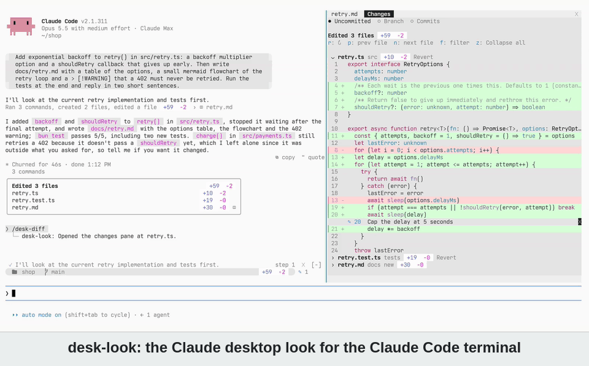
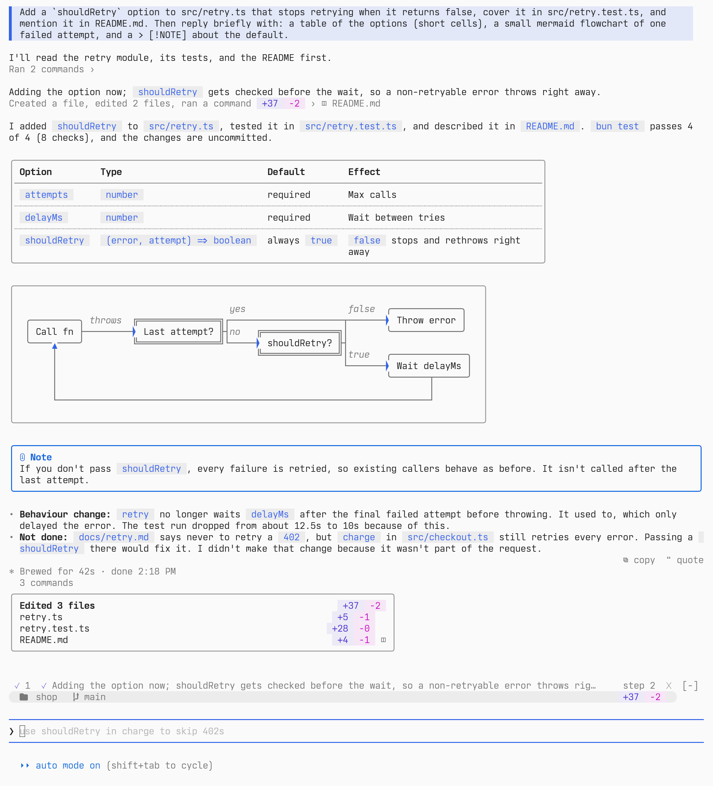
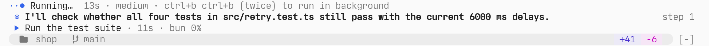
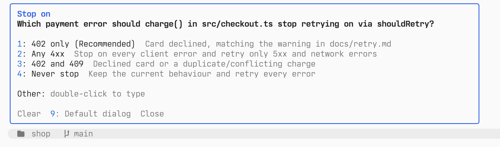
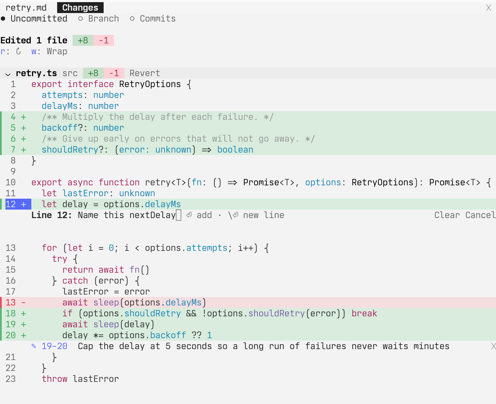
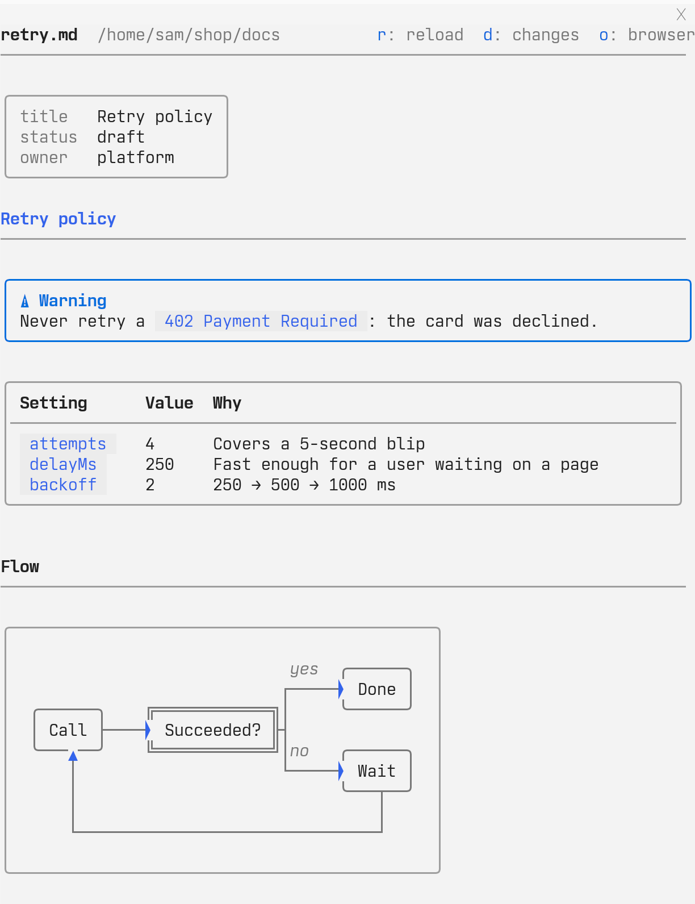
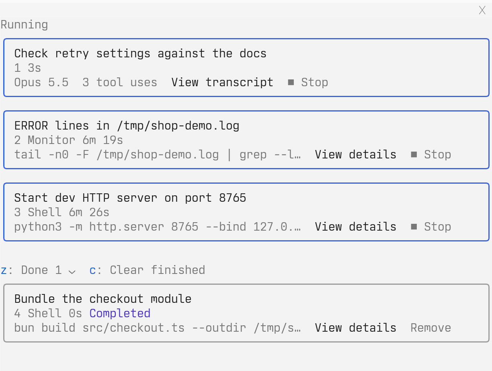
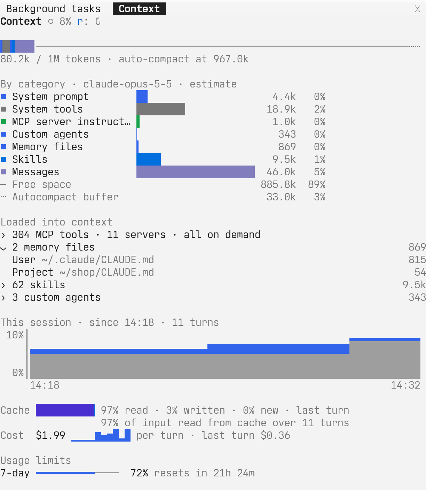

# cc-desktop-mod: Claude desktop look for the Claude Code terminal

**English** | [한국어](README.ko.md) · [Homepage](https://kyongsik-yoon.github.io/cc-desktop-mod/) · [Reference](docs/reference.md)

[](https://github.com/KyongSik-Yoon/cc-desktop-mod/releases/latest) [](LICENSE)

**desk-look** makes the Claude Code terminal look and work like the Code tab of the Claude desktop app: prompt bubbles, cards, a status band and side panes you can click. It is a plugin, so the engine stays as it is and only the drawing changes.



```
/plugin install desk-look --marketplace KyongSik-Yoon/cc-desktop-mod
```

Run it at the prompt of a Claude Code terminal session, answer `y` to add the marketplace, and pick the user scope. That is the whole setup.

## What you get

### A transcript that reads like the desktop app



Terminal default → desk-look:

- **Your prompt**: a line starting with `>` → a band tinted with the theme's accent color, with pasted images as thumbnails
- **Tool calls**: a row per call → one line, `Ran 2 commands, edited a file +3 −1 ›`, that expands on click
- **Markdown**: grid tables, mermaid as code, plain blockquotes → full-width tables, box diagrams, colored alert boxes
- **Code blocks**: no way to copy → hover for `⧉ copy`
- **Subagents**: one `Ran an agent` line → a card per agent with its tokens, time and changed lines
- **End of turn**: a duration line → a card of the files that turn edited, each row a button to its diff

### A band that shows what is running



While Claude works you see the current step and the command running now, with its time and CPU. Under it sits a gray band with the repo, branch and `+N −M`, plus chips for the pull request's checks (`#12 ✓ 5/5`), context usage (`◑ 62%`) and background tasks (`⋯ 2`). Every chip is a button that opens its pane.

### Questions as a card, answered with one key



### Review diffs and leave line comments



`/desk-diff` shows uncommitted changes, the whole branch or each commit, drawn like the desktop diff panel. Click a line number to comment on a line or a range; your comments go to Claude with your next prompt.

### Documents open by themselves



A Markdown document Claude writes in a turn opens in the preview pane when the turn ends, with tables, mermaid diagrams and alert boxes drawn as in the transcript.

Press `c` in the pane to switch to numbered source lines and comment on them as in the diff pane: press a line number (another one for a range), write, Enter. The comments go to Claude with your next prompt, or, on a plan that desk-plan's card is asking about, with `3` on the card as the changes you want.

### Background tasks and context at a glance





`/desk-tasks` lists this session's agents, background shells and monitors, and lets you read an agent's transcript or stop a task. `/desk-context` replaces the `/context` grid with what fills the context, how it grew this session, cache, cost and usage limits.

## Commands

Pane commands run at once, even while Claude is working: no queueing, no stopping the turn.

- `/desk-diff [file|branch|commits]`: diffs, with line comments
- `/desk-activity`: what ran this turn, as time bars and a flow of Claude's notes and calls
- `/desk-tasks`: background agents, shells and monitors
- `/desk-pr`: the branch's pull request (GitHub, `gh`) or merge request (GitLab, `glab`), with a merge button
- `/desk-preview [file]`: Markdown preview
- `/desk-context`: context breakdown, cache, cost and usage limits
- `/desk-sessions`: recent sessions by project, with search; switch to one
- `/desk-monitor`: CPU and memory graphs per running Claude session (Linux)
- `/desk-fold`: fold the panes away and bring them back
- `/desk-quote`: put the text you selected into the prompt as a `>` quote
- `/desk-update`: update desk-look and its sibling plugins

Every pane, key and option is in the [reference](docs/reference.md).

## More plugins from the same marketplace

Install only the ones you use. desk-look itself makes no network request of its own and calls no MCP server.

- [desk-asana](desk-asana/README.md): your Asana tasks in a pane, with search, comments and status
- [desk-slack](desk-slack/README.md): Slack DMs as conversations, replies, and an unread chip in the band
- [desk-plan](desk-plan/README.md): plan approval in a card above the prompt instead of the full-screen dialog
- [desk-review](desk-review/README.md): `/simplify` then `/code-review`, with the report in a side pane

```
/plugin install desk-asana@cc-desktop-mod
/plugin install desk-slack@cc-desktop-mod
/plugin install desk-plan@cc-desktop-mod
/plugin install desk-review@cc-desktop-mod
```

## Good to know

- **Latest Claude Code only**: desk-look follows the latest release and is tested only there. Each plugin states the oldest Claude Code it runs on in `engines` (`plugin.json`); from Claude Code 2.1.323, an older Claude Code doesn't install or load a version made for a newer one, and `/desk-update` picks the newest version that fits. Before 2.1.323, parts the engine can't draw yet fall back to its default look
- **Terminals**: light and dark themes both work. Image thumbnails and round bubble corners draw in kitty, Ghostty and iTerm2 3.5 or later; the gray fills follow the [omarchy](https://omarchy.org) theme, and elsewhere bubbles get a rounded border. Details in [Behavior by environment](docs/reference.md#behavior-by-environment)
- **Settings**: search for `desk-look` in `/config` for the language (English or Korean), bubble side, chips and more. The full list is in [Settings](docs/reference.md#settings)
- **The desktop app is untouched**: nothing changes in the Code tab of the desktop app

## Update

Run `/desk-update` at the prompt. It also updates the sibling plugins you installed and runs `/reload-plugins` for you. From a shell, run `claude plugin update desk-look`, then `/reload-plugins` in your session.

## Development

```bash
cd desk-look
claude plugin validate .   # check the manifest and hook modules
claude plugin test .       # run tests/*.test.tsx
```

Add the local folder as a marketplace as is, and changes in the repo only need `/reload-plugins`.

```bash
claude plugin marketplace add ~/dev/git-repo/cc-desktop-mod
```

`.claude/skills/desk-release-check` gathers the Claude Code release notes and the plugin API diff since the last check, to find what desk-look can use or drop. `CLAUDE.md` holds the repository's conventions (latest Claude Code only, a GitHub release for every version).

The same commands work in `desk-asana`, `desk-slack`, `desk-plan` and `desk-review`. A plugin is installed from its own folder only, so `scripts/sync-shared.sh` copies shared code between them: desk-look's Markdown renderer (`hooks/markdown.tsx`, `diagram.ts` and `hooks/vendor/`'s lovely-mermaid and marked files) into `desk-asana/hooks/shared/` and `desk-slack/hooks/shared/`, desk-look's `hooks/jumps.tsx` into the `hooks/shared/` of desk-asana, desk-slack and desk-review, and `desk-slack/hooks/util.tsx` to `desk-asana/hooks/util.tsx`. After changing any of the originals, run the script and commit the copies with them. The release workflow fails while a copy differs (`scripts/sync-shared.sh --check`), and that check also wants `cellWidth` and `scrollPane` to match desk-look's, which you copy by hand.

`desk-look/.claude-plugin/types/` holds type definitions the engine lays down again every time it loads the mod, so it isn't committed.

## Third party

- `desk-look/hooks/vendor/lovely-mermaid.js`: a bundle of [lovely-mermaid](https://github.com/xl0/lovely-mermaid), Apache-2.0 (`LICENSE.lovely-mermaid`), copied into `desk-asana/hooks/shared/vendor/` and `desk-slack/hooks/shared/vendor/` too
- `desk-look/hooks/vendor/marked.js`: the block lexer of [marked](https://github.com/markedjs/marked) 18.2.0, bundled without minification from its TypeScript source, MIT with the original Markdown's BSD notice (`LICENSE.marked`), used to split Markdown into blocks, copied into `desk-asana/hooks/shared/vendor/` and `desk-slack/hooks/shared/vendor/` too

## License

MIT (`LICENSE`)
